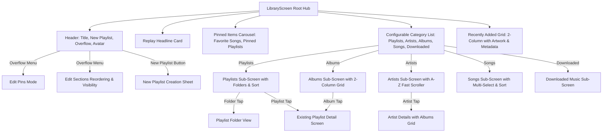

# Raaga Complete Library Architecture & Implementation Plan

## 1. Architectural Overview & Design Philosophy
This implementation brings the refined information architecture and UX discovered from Apple Music Android into Raaga, while strictly adhering to Raaga's native design system (AMOLED pure black `#000000`, Raaga pink/red accent, frosted glass surfaces, and existing Kotlin/Jetpack Compose architecture).

### Non-Negotiable Core Tenets:
- **Zero Mock Data**: Integrates directly with Raaga's real database, `LibraryPage` (shelves, liked songs, playlists), `LocalMediaRepository` (on-device audio), `Downloads` manager, and ExoPlayer playback engine.
- **Independent Identity**: Uses Raaga icons (`RaagaIcons`), Raaga typography, and Liquid Glass frosted surfaces rather than Apple clones or proprietary assets.
- **State Preservation**: All customizations (pinned items, section visibility, section ordering, sorting preferences) are persisted in `AppSettings` using StateFlow and Android SharedPreferences.

---

## 2. Component Hierarchy & Navigation Flow

---

## 3. Data & Persistence Layer (`AppSettings`)
1. **Library Section Visibility & Order**:
   - `librarySections`: Flow list of enabled section IDs (`PLAYLISTS`, `ARTISTS`, `ALBUMS`, `SONGS`, `DOWNLOADED`, `GENRES`).
2. **Pinned Items**:
   - `libraryPinnedItems`: Flow list of pinned IDs (e.g., `FAVORITE_SONGS`, playlist IDs, album IDs).
3. **Sorting**:
   - `playlistsSort`: Title, Recently Added, Recently Played.
   - `artistsSort`: Name, Recently Added.
   - `albumsSort`: Title, Artist, Year, Recently Added.
   - `songsSort`: Title, Artist, Album, Recently Added.
4. **Playlist Folders**:
   - `playlistFolders`: Local mappings of folder ID -> name and folder ID -> playlist IDs list.

---

## 4. Sub-Screens & Component Implementation Map
- `com.music.raaga.ui.screens.library`:
  - `LibraryHub.kt`: Main Apple Music-inspired Hub with Pinned items, categories, recently added, and edit modes.
  - `LibraryCategory.kt`: Category enum and metadata definitions.
  - `LibraryPinsEditor.kt`: In-place unpin and reorder editor.
  - `LibrarySectionsEditor.kt`: Reorderable and checkable sections editor.
  - `PlaylistsSubScreen.kt`: Playlists with folder support, search, and sorting bottom sheets.
  - `ArtistsSubScreen.kt`: A-Z fast scrolling artist list and artist details.
  - `AlbumsSubScreen.kt`: 2-column album grid with search and playback controls.
  - `SongsSubScreen.kt`: Comprehensive song list with multi-selection actions.
  - `DownloadedSubScreen.kt`: Offline music experience.
  - `NewPlaylistSheet.kt`: Custom artwork, title input, and creation flow.

